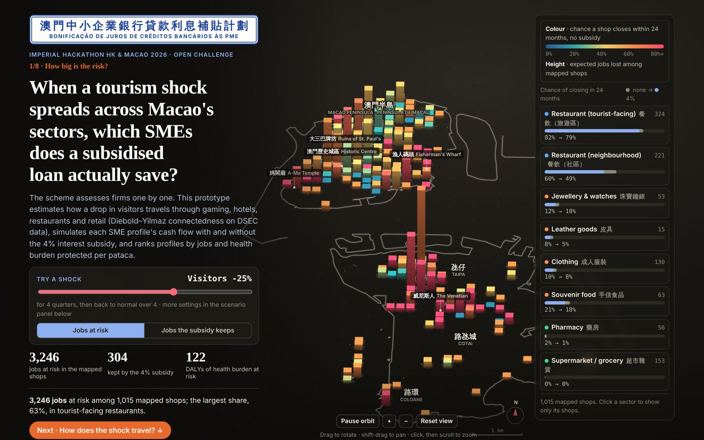

# Macao SME Subsidy Targeting

**Live prototype:** https://angelina-lm732.github.io/macao-sme-subsidy/

Imperial Hackathon Hong Kong & Macao 2026 · Open Challenge · team of 5. **My role:** science and modeling lead — model design, data simulation, the interactive prototype, part of the visualizations and the written proposal.

[](https://angelina-lm732.github.io/macao-sme-subsidy/)

Macao's 2026 Policy Address continues the SME Bank Loan Interest Subsidy Scheme, which assesses firms one by one. This prototype asks which SME profiles gain the most survival, jobs and health per pataca when a tourism shock spreads across sectors.

- **Science:** Diebold–Yilmaz connectedness (VAR on ten DSEC quarterly series, 2011–2026), back-tested against Macao's COVID shock.
- **Business:** monthly cash-flow simulation of 216 scheme-eligible SME profiles, 600 paths each, with and without the subsidy.
- **Medicine:** a health module converts protected jobs into avoided DALYs.
- **Technology:** a single self-contained web page (`index.html`) with a 3D risk map; it runs offline and re-ranks profiles live.

Default scenario (visitors −25% for four quarters): targeting saves 3.3× the jobs per pataca; firm-by-firm assessment misses 9 of the top 20; full interest for the top quarter and 3% for the rest protects 32% more jobs at 88% of the flat-rate cost.

## Limitations

- The model is built to stress-test shocks, not to forecast. Out of sample in 2025–2026 it did not forecast ordinary quarter-to-quarter growth better than a no-change rule.
- With no shock and no subsidy, the average profile's 24-month failure rate is 14.4%, against an SME loan delinquency ratio of 8.5% (AMCM, end-June 2026). The model leans pessimistic, mainly because restaurant profiles inherit the sector's negative 2024 margin.
- Job-loss health effects come from Korean panel data and international meta-analyses rather than Macao itself.

## Data and reproduction

Every number traces to a source listed on the page ("Method & sources") and in `README_数据来源与复现.md` (Chinese), which also gives the reproduction steps:

```
python3 scripts/01_prepare.py
python3 scripts/02_connectedness.py
python3 scripts/03_calibrate.py
node    scripts/03b_validate.js
node    scripts/06_sensitivity.js
python3 scripts/07_backtest.py
node    scripts/08_tiered.js
python3 scripts/05_build.py      # writes dashboard.html (copied to index.html here)
```

Requires Python 3 (numpy, pandas) and Node.js. Data: Macao Statistics and Census Service (DSEC), Macao SAR Government, AMCM; shop locations © OpenStreetMap contributors (ODbL).
